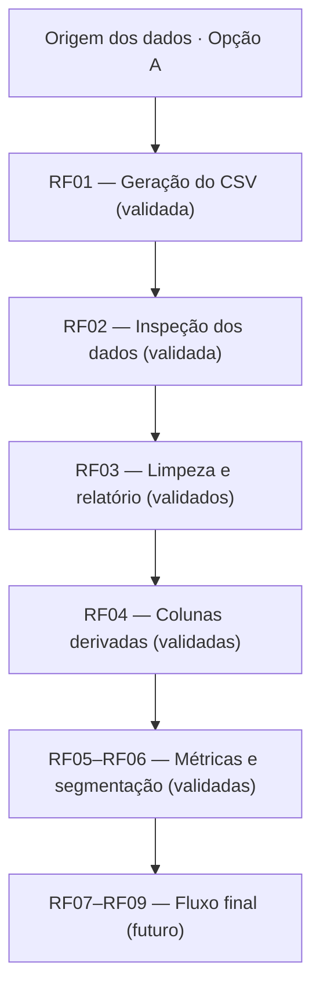

# SalesInsight PY — Análise de Dados de Vendas

**Projeto acadêmico:** SCTEC/SENAI — Desenvolvimento de IA para Análise Preditiva — Turma T4, Módulo 1 (Mini-Projeto da Semana 08).  
**Responsável acadêmico:** Fabiano Rodrigo Costa.

> **Status: RF01–RF06 implementados e validados localmente.** RF07–RF09 seguem planejados.

## Objetivo

Construir, em Python, um fluxo reprodutível de análise de vendas para uma empresa de varejo: carregar um CSV, inspecionar e limpar registros, criar colunas derivadas, agregar métricas, segmentar clientes e exportar resultados para CSV e JSON.

O escopo obrigatório segue a **versão reduzida do enunciado de 10/09/2026**, correspondente aos conteúdos do Módulo 1 até a Semana 05. Não exige Pandas, NumPy, Matplotlib, Seaborn, classes ou modelos preditivos.

## Escopo e rastreabilidade

- [Matriz RF01–RF09 e critérios de aceitação](planejamento/matriz-requisitos.md)
- [Kanban operacional](planejamento/tarefas-kanban.md)
- [Arquitetura e decisões técnicas](planejamento/arquitetura-tecnica.md)
- [Checklist de avaliação e entrega](planejamento/checklist-rubrica.md)

## Origem dos dados

A opção A, recomendada no enunciado, gera dados sintéticos em Python. A opção B permite usar um dataset externo, mediante adaptação aos campos e critérios de qualidade exigidos. A opção A foi adotada pela reprodutibilidade, pelo controle das inconsistências inseridas e pelo alinhamento ao gerador fornecido nas páginas 5 e 6 do enunciado.

## Jornada do dataset



## Estrutura

```text
salesinsight-py/
├── README.md
├── salesinsight.py           # preparação e análise de vendas
├── vendas.csv               # dados sintéticos de RF01
├── test_salesinsight.py      # testes de RF01–RF06
├── outputs/                 # relatórios CSV/JSON produzidos em RF08
└── planejamento/
    ├── matriz-requisitos.md
    ├── tarefas-kanban.md
    ├── arquitetura-tecnica.md
    └── checklist-rubrica.md
```

## Ambiente previsto (Windows / PowerShell)

Recomendação: Python 3.12, VS Code com extensão Python e GitHub Desktop. O trabalho obrigatório utiliza apenas a biblioteca padrão do Python; **não requer instalações de bibliotecas externas**.

```powershell
py -3.12 --version
py -3.12 -m venv .venv
.\.venv\Scripts\python.exe --version
```

Para executar RF01–RF06, rode na raiz do repositório:

```powershell
.\.venv\Scripts\python.exe -X utf8 salesinsight.py
```

O script carrega `vendas.csv` do diretório atual. Se o arquivo estiver ausente, ele executa o gerador da opção A e grava 200 registros sintéticos em UTF-8 com `seed=42`. A inspeção exibe as dimensões, os nomes das colunas, as ausências por coluna e as primeiras cinco linhas brutas. Em seguida, a execução exibe o relatório de limpeza, o primeiro registro transformado quando disponível, as métricas de vendas e a segmentação de clientes.

Para rodar os testes de RF01–RF06:

```powershell
.\.venv\Scripts\python.exe -m unittest -v
```

## Versionamento planejado

- `main`: versão estável, com integração final.
- `develop`: integração e validação das funcionalidades.
- `feat/dados-inspecao`: RF01–RF02.
- `feat/limpeza-transformacao`: RF03–RF04.
- `feat/metricas-segmentacao`: RF05–RF06.
- `feat/exportacao-fluxo`: RF07–RF09, revisando a organização das funções ao longo do fluxo.
- `docs/readme`: documentação final, verificações e link do vídeo.

Cada feature será criada a partir de `develop` atualizada, integrada mediante revisão e registrada por commits pequenos com mensagens descritivas.

## Resultados e demonstração

A execução de referência com Python 3.12.10 e `seed=42` produziu **200 registros e 8 colunas**. A inspeção identificou **10 ausências em `quantidade`**, **4 em `preco_unitario`** e zero nas demais colunas. O CSV contém ainda 4 datas marcadas como `DATA INVALIDA`, 11 produtos com espaços extras e 19 nomes de cliente com ruído.

O registro 2 tem quantidade vazia, o registro 11 contém `DATA INVALIDA` e o registro 12 contém o produto `" Headset "`. O preço unitário está vazio no registro 18.

A geração com os mesmos parâmetros produz o mesmo arquivo. O SHA-256 do CSV gerado em Python 3.12.10 é `5d8b1e07856f3b1ad4c433840cb1845643de3175450908f919cf83f7c21f0859`.

A limpeza recebeu **200 registros**, descartou **17** (4 por data inválida e 13 por ausência de quantidade ou preço) e manteve **183**. Cada linha é contada uma vez, com prioridade para data inválida. As variantes de cliente do gerador são normalizadas para `Cliente_NNN`. Nomes sem identificador reconhecível recebem a marca `cliente_fora_do_padrao`. Campos numéricos preenchidos que falham na conversão geram um erro de entrada.

A transformação acrescenta receita, mês, nome do mês em português, trimestre, ano e faixa de receita. As faixas são `Baixo Valor` abaixo de R$ 500, `Medio Valor` de R$ 500 até abaixo de R$ 5.000 e `Alto Valor` a partir de R$ 5.000. No registro 1, duas unidades a R$ 102,90 resultam em R$ 205,80 na faixa `Baixo Valor`, em maio de 2025 (Q2).

### Métricas e segmentação

Os 183 registros válidos somaram **1.031 unidades** e **R$ 1.290.346,30** de receita. Os totais por mês, categoria e região e os gastos dos 50 clientes identificados foram conferidos contra a receita dos registros válidos.

| Indicador | Resultado |
|---|---|
| Produto líder | Notebook · R$ 374.174,85 |
| Região líder em receita | Nordeste · R$ 366.321,23 em 42 vendas |
| Ticket médio no Nordeste | R$ 8.721,93 |
| Cliente líder | `Cliente_006` · R$ 65.905,09 |
| Distribuição de clientes | 6 Bronze, 10 Prata e 34 Ouro |

O ticket médio divide a receita da região pela quantidade de registros válidos da região. As somas usam centavos por registro. O agrupamento mensal usa o número do mês, e empates nos rankings são resolvidos pelo nome em ordem crescente. Linhas sem produto ou cliente informado entram nas métricas de vendas e ficam fora dos respectivos rankings. Valores vazios de categoria ou região têm agrupamento próprio.

A classificação com `lambda` usa o gasto acumulado. Bronze corresponde a menos de R$ 5.000, Prata vai de R$ 5.000 a R$ 15.000 inclusive e Ouro corresponde a mais de R$ 15.000.

A demonstração do fluxo completo e o link público do vídeo permanecem previstos para a entrega final. Ferramentas de IA foram utilizadas como apoio à implementação e à verificação técnica.

## Referência

Enunciado do AVA: *Desenvolvedor(a) em IA para Análise Preditiva [T4] — M1S08 — Mini-Projeto Avaliativo — SalesInsight PY*, versão reduzida datada de 10/09/2026. Prazo excepcional confirmado pela pedagogia no AVA: **30/11/2026, 23h59**. A versão consultada possui inconsistências de cabeçalho (T3) e de peso (30% em uma seção); o peso **25%** foi confirmado por Andrezza Finco para a T4.
