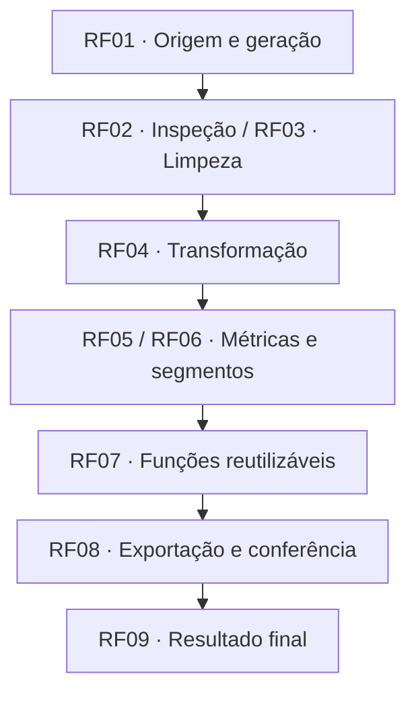
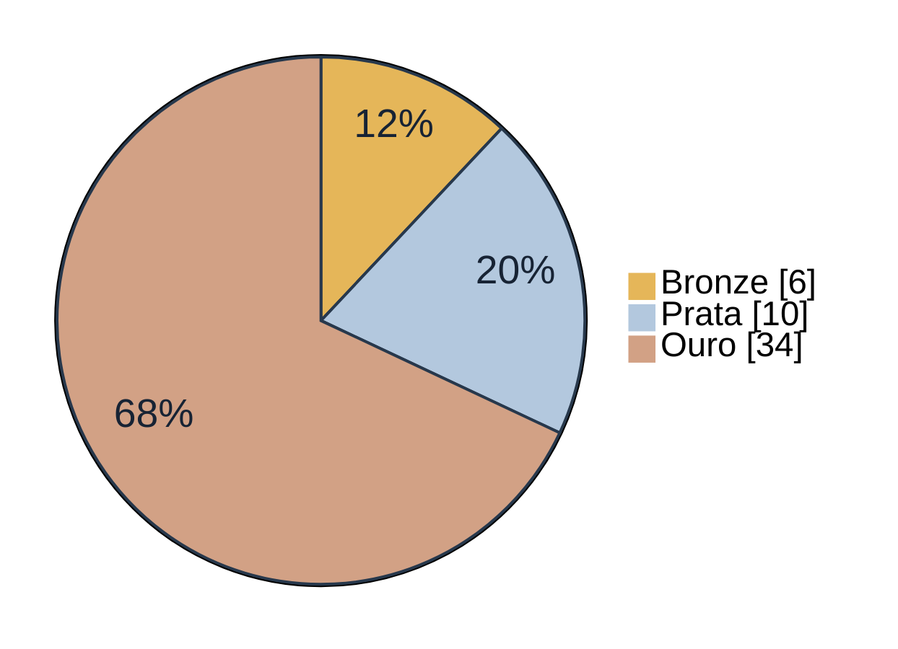

# SalesInsight PY — Análise de Dados de Vendas

- **Projeto acadêmico** — SCTEC/SENAI.
- **Curso** — Desenvolvimento de IA para Análise Preditiva.
- **Turma** — T4.
- **Módulo 1** — Fundamentos de Dados, Programação e Análise Preditiva com Python — 150 horas.
- **Atividade** — Mini-Projeto Avaliativo — Semana 08.
- **Responsável acadêmico** — Fabiano Rodrigo Costa.
- **Natureza** — Mini-projeto avaliativo de análise de dados.
- **Status** — RF01–RF09 implementados, validados e integrados em `develop`. O Gate 05 reúne a revisão editorial e a correção preventiva de permissões no Windows. A integração em `main`, o vídeo, seu link público e a submissão no AVA estão pendentes.

## Sumário executivo

O SalesInsight PY simula a rotina de análise de um varejo que precisa transformar registros de venda em informações para a gestão. A aplicação em Python inspeciona a fonte, descarta registros com dados essenciais ausentes ou datas inválidas, calcula métricas por mês, produto, categoria e região, e segmenta clientes pelo gasto acumulado. O console apresenta os resultados e o programa exporta dois CSVs e um JSON, que é relido para conferência.

A execução de referência começa com 200 registros sintéticos de 2025. A limpeza exclui 17 registros e entrega 183 vendas válidas, que somam 1.031 unidades e R$ 1.290.346,30 de receita. Os 50 clientes identificados se distribuem em 6 Bronze, 10 Prata e 34 Ouro. Em dados reais, o mesmo tipo de análise poderia orientar o acompanhamento de qualidade da entrada, o planejamento de estoque e a priorização de ações de relacionamento.

A biblioteca padrão do Python cobre todo o fluxo. A semente fixa garante uma entrada reproduzível e os 29 testes verificam desde a leitura até a exportação. A análise é descritiva e os resultados dizem respeito ao cenário sintético. As seções seguintes registram as evidências técnicas e o que falta para a entrega acadêmica.

## 1. 🌎 Contexto e relevância

A transformação digital amplia a importância da análise de dados na gestão empresarial. Segundo o *Future of Jobs Report 2025*, do Fórum Econômico Mundial, competências relacionadas à inteligência artificial e a Big Data estão entre as de maior crescimento esperado até 2030. O relatório também destaca o pensamento analítico como a competência central mais procurada pelos empregadores consultados em 2025. Essa competência ajuda a formular e resolver problemas com base em evidências. [World Economic Forum (2025)](https://www.weforum.org/publications/the-future-of-jobs-report-2025/)

No Brasil, o volume de vendas do comércio varejista registrou crescimento acumulado de **1,6% em 2025**, enquanto Santa Catarina alcançou **5,9%**. Os dois percentuais comparam o período de janeiro a dezembro de 2025 com o mesmo período de 2024, conforme a Pesquisa Mensal de Comércio do IBGE. Nesse ambiente, organizar informações de vendas, identificar padrões de consumo e acompanhar indicadores comerciais são práticas relevantes para apoiar decisões de gestão. [IBGE (2026a, tabela 2)](https://ftp.ibge.gov.br/Comercio_e_Servicos/Pesquisa_Mensal_de_Comercio/Fasciculo_Indicadores_IBGE/2025/pmc_202512caderno.pdf) · [Agência de Notícias do IBGE (2026b)](https://agenciadenoticias.ibge.gov.br/agencia-sala-de-imprensa/2013-agencia-de-noticias/releases/45894-vendas-no-varejo-fecham-2025-com-alta-de-1-6) · [SICOS (2026)](https://www.sicos.sc.gov.br/comercio-de-santa-catarina-avanca-59-em-2025-o-triplo-da-media-nacional/)

O **SalesInsight PY** está inserido nesse contexto como um projeto acadêmico de análise de dados desenvolvido em Python, no âmbito do SCTEC/SENAI. A aplicação simula um cenário de varejo, utilizando um dataset sintético e reproduzível para demonstrar técnicas de leitura, limpeza, transformação, agregação e segmentação de dados.

Seu propósito é consolidar competências fundamentais de programação e análise de dados, produzindo informações estruturadas que poderiam subsidiar decisões empresariais em aplicações futuras com dados reais. **Não são utilizados modelos preditivos nesta versão.**

## 2. 🎯 Problema de negócio e objetivo

Um varejo precisa saber quanto vendeu, quais produtos e regiões mais contribuíram para a receita e quais clientes acumularam os maiores gastos. Um CSV com datas inválidas, campos críticos vazios e identificadores inconsistentes dificulta responder a essas perguntas. Uma variação na grafia do cliente, por exemplo, pode dividir o gasto de uma mesma pessoa em registros que deveriam ser consolidados.

O objetivo é construir um fluxo reproduzível que documente os descartes, acrescente atributos de calendário e receita ao item e transforme vendas válidas em indicadores conferíveis. O programa entrega desempenho mensal, Top 5 de produtos por receita, agregações por categoria e região, ticket médio regional, Top 10 de clientes e distribuição por faixa de gasto.

A saída no terminal ajuda a investigar resultados durante a execução. Os CSVs permitem consultar as séries mensais e os segmentos por cliente, enquanto o JSON concentra os totais para conferência. Essas saídas respondem a perguntas sobre a base carregada e permitem revisar os critérios usados para chegar aos totais.

## 3. 📋 Escopo acadêmico e competências aplicadas

A atividade da Turma T4 integra o Módulo 1 — **Fundamentos de Dados, Programação e Análise Preditiva com Python — 150 horas**. A entrega segue a versão reduzida do enunciado de 10 de setembro de 2026, com os conteúdos trabalhados até a Semana 05. Os nove requisitos obrigatórios abrangem a obtenção da base, a análise descritiva e a exportação. A implementação usa somente a biblioteca padrão do Python, sem instalações de bibliotecas externas.

Listas e dicionários representam registros. Laços e condicionais sustentam a validação, as faixas de receita e os agrupamentos. `datetime` valida as datas e fornece atributos de calendário, e expressões regulares ajudam a padronizar os identificadores dos clientes sintéticos. A leitura e a escrita de arquivos usam `csv.DictReader`, `csv.DictWriter`, `json.dump()` e `json.load()`.

Funções com parâmetros, retornos e docstrings dividem o fluxo em etapas testáveis. `processar_coluna()` recebe uma função como argumento e é usado na segmentação. Uma expressão `lambda` ordena produtos, e outra determina a faixa de gasto de cada cliente. A matriz e a rubrica permitem conferir a cobertura acadêmica e as evidências de cada requisito. [Matriz de requisitos](planejamento/matriz-requisitos.md) · [Checklist da rubrica](planejamento/checklist-rubrica.md)

### 3.1 Tecnologias e ambiente de desenvolvimento

**Execução.** Python 3.12.10 e a biblioteca padrão sustentam a leitura, o tratamento, a análise e a exportação dos dados.

 

**Desenvolvimento e verificação.** O VS Code é usado para edição. O Git registra o histórico e o GitHub hospeda o repositório e as revisões. A suíte `unittest` teve 29 testes aprovados localmente no ambiente virtual.

  

## 4. 📊 Origem dos dados e jornada do dataset

A qualidade dos indicadores depende de conhecer os registros de entrada e as regras que os transformam. A jornada começa com a inspeção dos dados brutos e termina com a conferência dos arquivos de saída. A mesma fonte sintética permite repetir a execução e comparar resultados.

### 4.1 Origem e inspeção

A opção A do enunciado utiliza o gerador em Python descrito nas páginas 5 e 6. A semente `42` reproduz 200 registros de vendas de 2025 e permite inserir inconsistências de forma controlada. A opção B admite um CSV externo adaptado aos mesmos campos e critérios de qualidade. O programa usa `vendas.csv` quando ele existe e aciona o gerador somente se o arquivo estiver ausente.

As oito colunas brutas são `id_venda`, `data_venda`, `cliente`, `produto`, `categoria`, `regiao`, `quantidade` e `preco_unitario`. O console apresenta o tamanho da base, os nomes das colunas, a contagem de ausências por campo e até cinco linhas. Na referência há 10 quantidades e 4 preços vazios, com zero ausências nos demais campos. Há também quatro datas marcadas como `DATA INVALIDA`, 11 produtos com espaços extras e 19 nomes de clientes com ruído. No CSV bruto, o registro 2 tem quantidade vazia, o 11 traz uma data inválida, o 12 preserva os espaços em `" Headset "` e o 18 tem preço vazio. [Dataset de referência](vendas.csv)

### 4.2 Limpeza e transformação

A limpeza remove espaços em campos de texto, converte tipos e valida as datas. O programa descarta linhas com data inválida ou sem quantidade ou preço unitário. Cada descarte é contado uma única vez, com prioridade para a data inválida. Um campo numérico preenchido com texto inválido gera erro de entrada. As variantes dos identificadores sintéticos são normalizadas para `Cliente_NNN`, e os nomes fora do padrão recebem a marca `cliente_fora_do_padrao`.

A transformação calcula a receita do item (quantidade × preço unitário) e deriva o número e o nome do mês em português, o trimestre e o ano. As faixas são `Baixo Valor` abaixo de R$ 500, `Medio Valor` de R$ 500 até abaixo de R$ 5.000 e `Alto Valor` a partir de R$ 5.000. No registro 1, duas unidades a R$ 102,90 geram R$ 205,80 em maio de 2025 (Q2), na faixa `Baixo Valor`.

### 4.3 Do CSV ao resumo final

O fluxo separa a obtenção da base, a preparação das linhas, a análise e a publicação dos relatórios. A etapa RF07 representa a reutilização de funções no fluxo, incluindo a função de ordem superior aplicada na segmentação.



## 5. 🏗️ Arquitetura do software e requisitos RF01–RF09

A arquitetura é um fluxo de linha de comando. Em `salesinsight.py`, `main()` coordena as funções na ordem que garante que apenas registros válidos cheguem às agregações. Cada função resolve uma etapa ou agrupa uma regra de negócio, o que permite verificar a leitura, as transformações e as exportações separadamente. [Código principal](salesinsight.py) · [Arquitetura técnica](planejamento/arquitetura-tecnica.md)

Em telas estreitas, deslize as tabelas na horizontal para ler todas as colunas.

| RF | Responsabilidade | Evidência no fluxo |
|---|---|---|
| RF01 | Gerar ou carregar o CSV | `gerar_dataset_vendas()` e `carregar_dataset()` |
| RF02 | Inspecionar os dados brutos | `inspecionar_dados()` e resumo no console |
| RF03 | Limpar e validar os registros | `limpar_dados()` e contagem dos descartes |
| RF04 | Criar colunas derivadas | `criar_colunas_derivadas()` |
| RF05 | Calcular as agregações de vendas | `calcular_metricas()` |
| RF06 | Segmentar os clientes | `segmentar_clientes()` e Top 10 no console |
| RF07 | Aplicar funções reutilizáveis e `lambda` | `processar_coluna()`, classificação e ordenação |
| RF08 | Exportar e conferir os relatórios | `exportar_resultados()` e releitura do JSON |
| RF09 | Executar o fluxo completo | `main()` e ponto de entrada do script |

As somas monetárias usam centavos por registro. O agrupamento mensal usa o número do mês. O ticket médio de uma região é a receita dessa região dividida pelo número de vendas válidas. Empates nos rankings são resolvidos pelo nome em ordem crescente. Rótulos vazios de produto ou cliente ficam fora dos respectivos rankings, e categorias ou regiões vazias recebem um agrupamento próprio.

Na segmentação, o programa soma a receita por identificador de cliente. Bronze corresponde a gasto abaixo de R$ 5.000, Prata vai de R$ 5.000 a R$ 15.000 inclusive, e Ouro corresponde a gasto acima de R$ 15.000. `calcular_estatisticas()` consolida as contagens de limpeza, vendas, unidades, receita e segmentos para o JSON.

## 6. 📈 Resultados, indicadores e validação

Os KPIs abaixo vêm da execução local com Python 3.12.10 e semente `42`. O relatório de limpeza explica a diferença entre a entrada e as vendas válidas. Os CSVs e o JSON permitem conferir os totais. As interpretações mostram como cada medida poderia apoiar decisões em um varejo com dados reais.

### 6.1 Painel executivo da base sintética

| Base e qualidade | Vendas e clientes |
|---|---|
| **200**<br>Registros brutos | **1.031**<br>Unidades vendidas |
| **17**<br>Descartes | **R$ 1.290.346,30**<br>Receita total |
| **183**<br>Vendas válidas | **50**<br>Clientes identificados |

### 6.2 Indicadores detalhados e validação

| Indicador | Valor sintético | Interpretação |
|---|---:|---|
| Registros originais | 200 | Define o tamanho da entrada e a base da conferência. |
| Descartes | 17 | Foram quatro por data inválida e 13 por ausência de quantidade ou preço. O detalhamento ajuda a priorizar melhorias de cadastro. |
| Vendas válidas | 183 | É a base usada nas métricas. Fecha a reconciliação com os 200 registros originais. |
| Unidades vendidas | 1.031 | A soma da quantidade ajuda a acompanhar o volume e a planejar a reposição. |
| Receita total | R$ 1.290.346,30 | A soma da receita dos itens permite comparar meses, produtos, categorias e regiões. |
| Clientes identificados | 50 | Mostra a cobertura da segmentação e a população usada nas faixas. |
| Distribuição por segmento | 6 Bronze, 10 Prata e 34 Ouro | Descreve o perfil de gasto acumulado e poderia apoiar ações de relacionamento por faixa. |

O **Notebook** liderou o ranking de produtos, com R$ 374.174,85 de receita. O **Nordeste** liderou por região, com R$ 366.321,23 em 42 vendas e ticket médio de R$ 8.721,93. `Cliente_006` apresentou o maior gasto acumulado, de R$ 65.905,09. Esses recortes ajudam a formular perguntas sobre composição do faturamento e prioridades comerciais em uma aplicação real.

O CSV mensal reúne 12 linhas com receita, unidades e número de vendas. O CSV de segmentação apresenta os 50 clientes com identificação, gasto acumulado e segmento. O JSON reúne os totais de limpeza, vendas, quantidade, receita e distribuição. Os três arquivos usam UTF-8. Os CSVs usam vírgula como separador de campos e ponto como separador decimal. [Métricas por mês](outputs/metricas_por_mes.csv) · [Segmentação de clientes](outputs/segmentacao_clientes.csv) · [Estatísticas gerais](outputs/estatisticas_gerais.json)

Na validação, os totais por mês, categoria e região fecharam com a receita de referência. A soma dos gastos dos clientes também fechou com esse total. Para a mesma entrada, duas execuções em diretório temporário produziram arquivos idênticos byte a byte. A conferência de integridade confirmou os 200 registros e o SHA-256 do dataset de referência. [Suíte de testes](test_salesinsight.py)

### 6.3 Distribuição dos clientes

Dos 50 clientes sintéticos identificados, **6 são Bronze (12%)**, **10 são Prata (20%)** e **34 são Ouro (68%)**. Os percentuais usam o total de clientes como denominador.



## 7. 💡 Decisões técnicas, interpretações e limitações

As escolhas abaixo equilibram a cobertura da rubrica, a facilidade de reprodução e a conferência dos resultados. A tabela explicita o que cada decisão resolve e o efeito esperado no uso e na avaliação do projeto.

| Decisão técnica | Alternativa considerada | Justificativa | Impacto |
|---|---|---|---|
| Dataset sintético | CSV externo | O gerador controla as inconsistências e permite a mesma referência para todos. | Facilita repetir a análise com dados conhecidos. |
| Semente `42` | Semente variável | Torna determinística a geração dos 200 registros. | O hash e os totais podem ser comparados entre execuções. |
| Biblioteca padrão | Pacotes externos | As bibliotecas nativas cobrem os requisitos da versão reduzida. | A instalação se limita ao Python e à criação do ambiente virtual. |
| Descartar linhas inválidas ou incompletas | Imputar valores | Datas, quantidades e preços precisam ser confiáveis para as agregações. | O descarte é rastreável e a análise cobre apenas as linhas válidas. |
| Segmentos por gasto acumulado | Faixas relativas | Os limites fixos seguem o enunciado e são fáceis de conferir. | Cada cliente recebe uma classe e a distribuição fica explícita. |
| Funções e expressões `lambda` | Lógica concentrada no script | Funções isolam regras e as expressões curtas servem à ordenação e à classificação. | A mesma função pode ser reutilizada e os testes verificam seu comportamento. |
| Reexecução e conferência | Inspeção visual do terminal | A releitura do JSON e a comparação das saídas verificam o conteúdo gravado. | O resultado pode ser reproduzido e auditado. |
| Reserva com herança de permissões | Temporários em pasta privada | Um movimento no mesmo volume NTFS pode manter a ACL de origem. | A reserva herda as permissões de `outputs/` para a gravação e a recuperação. |

No diagnóstico do Windows, a área criada com `TemporaryDirectory` tinha permissões restritas. Ao mover o arquivo preparado com `Path.replace()`, o relatório conservou essas permissões. No Gate 05, a preparação e as cópias de recuperação passaram a usar a própria reserva sob `outputs/`, que herda as permissões desse diretório. A substituição por arquivo, a restauração em falhas tratáveis e a conferência do JSON continuam previstas no fluxo. [Arquitetura técnica](planejamento/arquitetura-tecnica.md) · [Documentação da Microsoft](https://learn.microsoft.com/en-us/troubleshoot/windows-client/windows-security/permissions-on-copying-moving-files)

A base cobre um ano sintético e o agrupamento mensal usa apenas o número do mês. O uso com dados de múltiplos anos exigiria revisar essa chave para incluir o ano. Os segmentos usam somente o gasto acumulado, e o conjunto de dados não contém custos para calcular margem. Uma evolução pode testar dados reais anonimizados, acompanhar a frequência e a recência de compras e verificar a qualidade das séries antes de examinar sua sazonalidade. Essas possibilidades dependem de dados adequados e estão fora da implementação atual.

## 8. ⚙️ Ambiente, estrutura do repositório e execução

A estrutura separa o script, a entrada bruta, os testes, os relatórios e o planejamento. A execução foi validada em Windows com PowerShell e Python 3.12.10. O Git permite obter uma cópia da branch que contém o Gate 04, e o VS Code pode ser usado para navegar pelo código e pela documentação.

### 8.1 Estrutura do repositório

```text
salesinsight-py/
├── README.md                 # documentação e execução
├── salesinsight.py           # fluxo de análise
├── vendas.csv                # dados sintéticos de entrada
├── test_salesinsight.py      # testes automatizados
├── outputs/                  # relatórios de referência
│   ├── .gitkeep              # marcador da pasta
│   ├── metricas_por_mes.csv
│   ├── segmentacao_clientes.csv
│   └── estatisticas_gerais.json
└── planejamento/             # documentação técnica
    ├── matriz-requisitos.md
    ├── tarefas-kanban.md
    ├── arquitetura-tecnica.md
    └── checklist-rubrica.md
```

### 8.2 Instalação e execução

Em uma cópia nova, clone o repositório pela branch `develop`, que contém RF01–RF09.

```powershell
git clone -b develop https://github.com/fabcosta-br/salesinsight-py.git
cd salesinsight-py
```

Na raiz do projeto, crie o ambiente virtual, confira a versão e execute o script.

```powershell
py -3.12 -m venv .venv
.\.venv\Scripts\python.exe --version
.\.venv\Scripts\python.exe -X utf8 salesinsight.py
```

A execução apresenta a inspeção, os descartes, um exemplo de transformação quando há vendas válidas, as métricas, a segmentação e o resumo. O programa usa o `vendas.csv` existente como entrada e grava os relatórios em `outputs/` no diretório de execução. Em uma pasta limpa, sem o CSV, o gerador produz a base sintética antes de começar a análise.

## 9. 🔀 Versionamento, testes e demonstração em vídeo

O histórico do Git registra a evolução por requisito e o estado da entrega. A suíte local confirma a execução técnica. A apresentação em vídeo e a submissão ao AVA são etapas acadêmicas próprias e permanecem pendentes.

### 9.1 Branches e integrações

| Branch | Escopo e estado |
|---|---|
| `main` | Versão estável. Integração final pendente. |
| `develop` | Integração dos quatro primeiros gates. |
| `feat/dados-inspecao` | RF01–RF02 · PR nº 1 (`e8f331d`). |
| `feat/limpeza-transformacao` | RF03–RF04 · PR nº 2 (`7bd726d`). |
| `feat/metricas-segmentacao` | RF05–RF06 · PR nº 3 (`1f53ee1`). |
| `feat/exportacao-fluxo` | RF07–RF09 · Commit `6f4ac6c` e PR nº 4 (`adf9233`). |
| `docs/readme` | Revisão editorial e correção preventiva de permissões do exportador. |

As branches de funcionalidade partem de `develop` e são integradas após revisão do incremento. O Gate 04 reúne a execução completa e a exportação verificada. [Kanban](planejamento/tarefas-kanban.md) · [PR nº 4](https://github.com/fabcosta-br/salesinsight-py/pull/4)

### 9.2 Testes locais e evidências

A suíte possui 29 testes, incluindo os 20 de RF01–RF06. Os casos cobrem geração, leitura e limpeza, métricas e segmentação, função de ordem superior e os dois usos de `lambda`. A validação da exportação verifica cabeçalhos, conteúdo relido, consistência dos totais e recuperação após falhas de escrita ou substituição. Também executa o fluxo do zero em diretório temporário com `site-packages` desativado. [Suíte de testes](test_salesinsight.py)

```powershell
.\.venv\Scripts\python.exe -m unittest -v
```

### 9.3 Vídeo e entrega no AVA

- **Demonstração em vídeo** — gravação pendente. O enunciado prevê até cinco minutos para apresentar a execução, o ambiente, o Kanban, as branches, uma decisão técnica e uma oportunidade de melhoria.
- **Link público do vídeo** — pendente de gravação, publicação e conferência de acesso.
- **Submissão no AVA** — pendente. O prazo oficial registrado no AVA é **30 de novembro de 2026, às 23h59**. A entrega inclui os links do repositório público e do vídeo, seguidos da conferência do recebimento.

Ferramentas de IA foram utilizadas como apoio à implementação, à revisão da documentação e à verificação técnica.

## 10. 📚 Referências e considerações finais

### 10.1 Referências bibliográficas e institucionais

As referências registram o enunciado e os documentos que embasam o projeto, as fontes de contexto do varejo e de competências profissionais e a documentação consultada para diagnosticar o comportamento das permissões no Windows.

COSTA, Fabiano Rodrigo. **SalesInsight PY**: documentação técnica do projeto. GitHub, 2026. Disponível em: [arquitetura técnica](planejamento/arquitetura-tecnica.md), [checklist da rubrica](planejamento/checklist-rubrica.md), [matriz de requisitos](planejamento/matriz-requisitos.md) e [Kanban](planejamento/tarefas-kanban.md). Acesso em: 25 nov. 2026.

INSTITUTO BRASILEIRO DE GEOGRAFIA E ESTATÍSTICA. **Pesquisa mensal de comércio**: dezembro de 2025. Rio de Janeiro: IBGE, 2026a. Tabela 2. Disponível em: [caderno de indicadores](https://ftp.ibge.gov.br/Comercio_e_Servicos/Pesquisa_Mensal_de_Comercio/Fasciculo_Indicadores_IBGE/2025/pmc_202512caderno.pdf). Acesso em: 25 nov. 2026.

INSTITUTO BRASILEIRO DE GEOGRAFIA E ESTATÍSTICA. **Vendas no varejo fecham 2025 com alta de 1,6%**. Agência de Notícias, 13 fev. 2026b. Disponível em: [divulgação do IBGE](https://agenciadenoticias.ibge.gov.br/agencia-sala-de-imprensa/2013-agencia-de-noticias/releases/45894-vendas-no-varejo-fecham-2025-com-alta-de-1-6). Acesso em: 25 nov. 2026.

MICROSOFT. **How permissions are handled when you copy and move files and folders**. Microsoft Learn, 12 fev. 2026. Disponível em: [nota técnica KB 310316](https://learn.microsoft.com/en-us/troubleshoot/windows-client/windows-security/permissions-on-copying-moving-files). Acesso em: 25 nov. 2026.

SANTA CATARINA. Secretaria de Estado de Indústria, Comércio e Serviço. **Comércio de Santa Catarina avança 5,9% em 2025, o triplo da média nacional**. Florianópolis, 6 out. 2026. Disponível em: [publicação da SICOS](https://www.sicos.sc.gov.br/comercio-de-santa-catarina-avanca-59-em-2025-o-triplo-da-media-nacional/). Acesso em: 25 nov. 2026.

SCTEC; SENAI. **Desenvolvedor(a) em IA para Análise Preditiva [T4]**: mini-projeto avaliativo, Módulo 1, Semana 08, SalesInsight PY. Versão reduzida, 10 set. 2026. Material didático no AVA.

WORLD ECONOMIC FORUM. **The future of jobs report 2025**. Geneva: World Economic Forum, 2025. Disponível em: [relatório institucional](https://www.weforum.org/publications/the-future-of-jobs-report-2025/). Acesso em: 25 nov. 2026.

### 10.2 Considerações finais e evolução futura

O SalesInsight PY concluiu RF01–RF09 e demonstrou um fluxo reproduzível, da entrada sintética à conferência dos relatórios. Os 200 registros de origem resultaram em 183 vendas válidas, com 1.031 unidades, R$ 1.290.346,30 em receita e 50 clientes identificados. A base cobre um ano simulado de vendas, e os indicadores descrevem esse cenário.

Uma possível V2.0 começaria pela qualidade dos dados. As prioridades abaixo representam propostas para evolução futura.

1. Adotar um dataset real devidamente anonimizado e ampliar a validação de datas, identificadores, duplicidades e campos essenciais.
2. Calcular indicadores por mês e ano para comparar períodos de múltiplos anos.
3. Criar um dashboard interativo para consultar os indicadores, os recortes e a qualidade da entrada.
4. Avaliar estudos preditivos quando houver dados adequados, disponíveis e validados.

### 10.3 Responsável acadêmico e contato

Este mini-projeto foi desenvolvido por Fabiano Rodrigo Costa, estudante da Turma T4 do curso Desenvolvimento de IA para Análise Preditiva, no âmbito do Módulo 1 — Fundamentos de Dados, Programação e Análise Preditiva com Python (150 horas). A atividade consolida fundamentos de programação, tratamento de dados e análise descritiva aplicados a um cenário simulado de varejo.

[LinkedIn](https://www.linkedin.com/in/fabianorodrigocosta/) · [GitHub](https://github.com/fabcosta-br)

---

*SalesInsight PY · Fabiano Rodrigo Costa · SCTEC/SENAI · Turma T4 · 2026 · Submissão no AVA pendente · Documentação candidata à versão 1.0*
